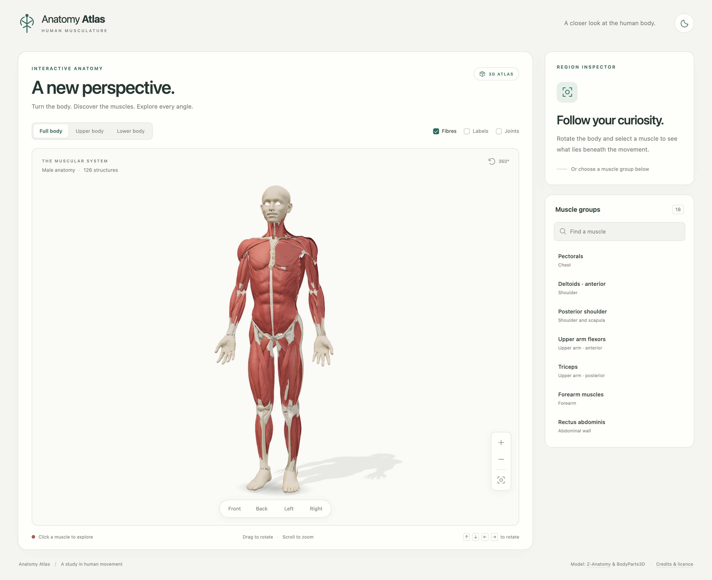

# Anatomy Atlas

An interactive Three.js atlas with one rotatable male anatomical model. Explore muscles from every angle, select individual structures, and browse 18 anatomical groups with search and an accessible inspector. Selecting a muscle also opens a visual exercise library with demonstration photos, equipment filters, and optional step-by-step instructions.

The view includes detailed muscles and tendons, studio lighting, ambient occlusion, selection highlights, fibre detail, labels, joint landmarks, full/upper/lower-body framing, and light/dark appearance. The model and all rendering dependencies are served locally; the running atlas does not fetch models or scripts from a CDN.



## Run

Requires Node.js **22.12 or later**.

```sh
npm ci
npm run dev
```

Open http://localhost:4173. `npm start` starts the same development server. Use `PORT=4174 npm run dev` for another port.

Drag to rotate, scroll or pinch to zoom, and right-drag or use two fingers to pan. Camera buttons provide front/back/side views and reset. With the canvas focused, arrow keys rotate, `+`/`-` zoom, and `Home` resets. Use the muscle browser and inspector with `Tab` and `Enter`; `Escape` closes an exercise dialog first, then clears the anatomy selection.

## Validate and build

```sh
npm run check
npm test
npm run build
node server.mjs --production
```

`check` validates JavaScript and decodes the delivered model to verify mesh references, anatomical identities and sides, all 18 groups, geometry dimensions, embedded resources, compression, and licences. Browser tests use an installed Google Chrome and start their own production server on port 4181. They cover selection/search, camera controls, mobile layout, keyboard interaction, saved preferences, asset retry, unavailable WebGL, local-only requests, and production routing.

The build recreates `dist/` with optimized application bundles, `assets/anatomy/`, and `assets/exercises/`. The production server accepts `PORT`, serves only the root page and public assets, and returns 404 for unknown routes. Conversion scripts are excluded from the distribution. Browser screenshots, performance measurements, and failure traces are written to the ignored `test-results/` directory.

WebGL 2 is required for the 3D view. If it is unavailable, the HTML muscle browser and inspector remain usable. Rendering adapts during camera motion, then restores full-resolution colour and ambient occlusion for stationary inspection. Non-Retina views receive modest supersampling; Retina rendering is capped at 2×. Quality checks also simulate a slow GPU to verify that reduced interaction resolution never persists after movement stops.

The model contains 126 selectable structures across 18 groups, with 2,246,073 triangles and a 19.7 MiB compressed download. Muscle surfaces and tendon junctions receive bounded smoothing, 22 broad surfaces receive additional contour geometry, and 2K normal/roughness maps provide fine fibre detail. Compression retains 14-bit shading normals. Quality tests capture close-ups, record orbit performance, and verify full-resolution rendering after camera motion. Mobile test results use desktop viewport emulation, not a physical-phone benchmark. Some fine attachment irregularities remain in the source anatomy.

## Exercise library

Select a muscle, then use **Explore exercises** in the inspector to jump to its photo cards below the 3D view. Search by name, filter equipment or primary/supporting muscle role, and open a card to switch between movement photographs. Written instructions stay in an expandable section. All exercise data is served locally, loaded only when a muscle is selected. The library also works without WebGL.

The dataset is [hasaneyldrm/exercises-dataset](https://github.com/hasaneyldrm/exercises-dataset), pinned to `7455efae41b330c265e7cd4b78dfa848e7ce5ebd`. Matches use the dataset's muscle tags, apply to either anatomical side, and are group-level rather than individual anatomical subdivisions. Broad tags and missing coverage are explained in the interface; tibialis anterior has no explicitly tagged entries.

```sh
npm run import:exercises
npm run import:exercise-media
npm run test:exercises
```

The English metadata and instructions retain the upstream MIT licence and provenance. Gym Visual images/GIFs have separate licensing and are **not included**. Instead, original photographs from [Free Exercise DB](https://github.com/yuhonas/free-exercise-db) are served locally under its public-domain Unlicense, pinned to `f00c92c7dcf1216a928a52c3706c7ce8e2f71ed5`. Only exercises with a verified name/variant match receive photo cards; the full original text catalog is retained. There is no substitute image for an unmatched exercise. See [media provenance](docs/exercise-media-research.md). See [exercise dataset provenance and mapping](docs/exercises-dataset.md). Browser tests cover filters, instruction dialogs, keyboard focus, mobile/dark appearance, delayed loading, retry, and WebGL fallback.

## Rebuild the anatomy assets

The ready-to-use GLB and anatomical manifest are included, so Blender is **not** required to run or build the application. To regenerate them, obtain **Blender 4.5 LTS** and **Python 3**, then run:

```sh
npm run fetch:anatomy
BLENDER_PATH=/path/to/blender npm run prepare:anatomy
npm run check:anatomy
```

The source is pinned to Z-Anatomy revision `6271cab1422c5b7baf7ee2a16ac21695da1bb295`. Source downloads and intermediates belong in `.cache/`, which is excluded from version control and distribution. The conversion extracts named muscle subdivisions and supporting anatomy, normalizes the coordinate system, writes stable metadata and joint anchors, and produces a Meshopt-compressed GLB. See [anatomy structure and provenance](docs/anatomy.md) for exact conversion details and source checksums.

## Model attribution

The adapted anatomical model is derived from **Z-Anatomy** by Gauthier Kervyn and contributors, based on **BodyParts3D** by the Database Center for Life Science. Adapted model assets are distributed under **CC BY-SA 4.0**. Credits, upstream notices, and modification details ship with the model in `public/assets/anatomy/NOTICE.txt`, `LICENSE.txt`, and `UPSTREAM-LICENSE.txt`.

- [Z-Anatomy source](https://github.com/Z-Anatomy/Models-of-human-anatomy)
- [Creative Commons Attribution-ShareAlike 4.0](https://creativecommons.org/licenses/by-sa/4.0/)

This is a visual educational atlas of superficial anatomy, not a complete catalogue of internal structures. Fine fibre shading is a visual material treatment; it is not histological imaging.
